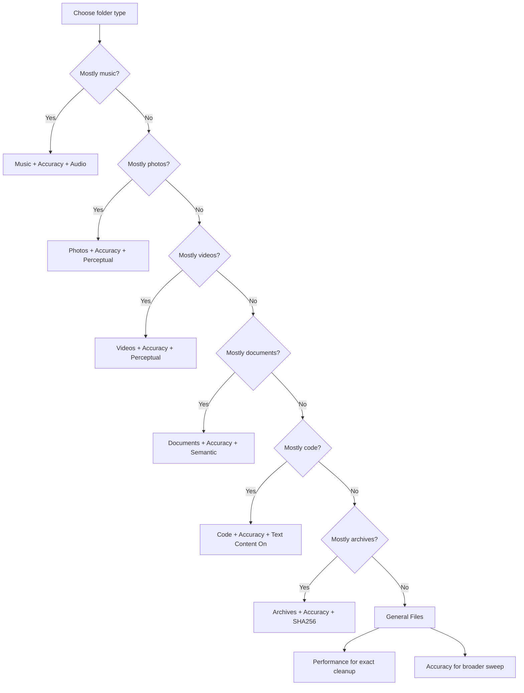

# 🎯 Advanced Duplicate File Finder

A cutting-edge GUI application for finding and managing duplicate files with **AI-powered similarity detection** and modern professional interface. Built with Python + PyQt6 for robust desktop performance.

## ✨ Key Features

### 🧠 AI-Powered Detection
- **Audio Fingerprinting**: Advanced chromaprint + librosa analysis for music duplicates
- **Video Scene Detection**: Multi-keyframe analysis for video content similarity  
- **Text Similarity Scoring**: Semantic AI analysis with adjustable thresholds (0.50-0.95)
- **Perceptual Image Hashing**: Visual similarity detection beyond exact matches
- **Traditional Hashing**: MD5/SHA256 for exact duplicate detection

### 🎛️ Advanced Features
- **6 Detection Algorithms**: Choose the perfect method for your file types
- **Smart Similarity Thresholds**: Real-time adjustment for text similarity scoring
- **Complete Undo System**: Full backup and restore for safe file management
- **Batch Operations**: Multi-select with smart grouping and mass operations
- **Intelligent Filtering**: File types, size ranges, modification dates, and custom patterns
- **Live Preview**: Built-in viewers for images, text, and file properties

### 🎨 Modern Interface
- **Tabbed Design**: Organized scan options, results, and file operations
- **Dark/Light Themes**: Professional theming with system-wide application
- **Smart Search**: Real-time filtering of duplicates by filename or path
- **Enhanced Progress**: ETA display and current file tracking
- **Keyboard Shortcuts**: Full hotkey support for power users (Ctrl+P, Ctrl+A, Del, etc.)
- **Live Preview**: Built-in viewers for images, text, and file properties

### 🔍 Enhanced User Experience
- **Search Within Results**: Instant filtering of duplicate groups
- **Progress Details**: Real-time ETA and current file display
- **Theme Toggle**: Dark/light mode with persistent settings
- **Keyboard Navigation**: Complete shortcut system for efficiency
- **Visual Feedback**: Emoji indicators and smooth animations
- **Status Updates**: Comprehensive progress and operation feedback

## 🚀 Quick Start

### Installation
```bash
pip install -r requirements_enhanced.txt
```

### Launch Application
```bash
python main_enhanced.py
```

### Basic Usage
1. **Select Directory**: Browse to folder containing potential duplicates
2. **Choose Algorithm**: Pick detection method based on file types
3. **Set Filters**: Optional file type, size, or date filtering
4. **Configure Similarity**: Adjust text similarity threshold if using AI detection
5. **Start Scan**: Begin analysis with real-time progress tracking
6. **Review Results**: Examine groups with similarity scores and preview
7. **Take Action**: Delete, move, or export duplicate findings

## ⌨️ Keyboard Shortcuts

| Shortcut | Action | Description |
|----------|--------|-------------|
| **Ctrl+O** | Browse Directory | Open folder selection dialog |
| **Ctrl+P** | Preview File | Show preview of selected file |
| **Ctrl+A** | Select All | Select all duplicate files |
| **Ctrl+Z** | Undo | Undo last deletion operation |
| **Ctrl+E** | Export Results | Save duplicate report to CSV |
| **Ctrl+Q** | Exit | Close the application |
| **Del** | Delete Selected | Delete checked duplicate files |

## 🔍 Search & Filter

- **Real-time Search**: Type in the search box to filter duplicates instantly
- **Smart Filtering**: Search by filename, path, or file extension
- **Live Results**: See filtered results update as you type
- **Clear Search**: Click ✖ to reset and show all duplicates

## 🎯 Algorithm Guide

| Method | Best For | Similarity Type | Speed |
|--------|----------|----------------|-------|
| **Audio Fingerprint** | Music, Podcasts | Content-based | ⚡⚡ |
| **Video Scenes** | Movies, Videos | Visual scenes | ⚡⚡ |
| **Text Similarity** | Documents, Code | Semantic content | ⚡ |
| **Perceptual** | Photos, Images | Visual similarity | ⚡⚡⚡ |
| **MD5** | General files | Exact matches | ⚡⚡⚡ |
| **SHA256** | Security-focused | Exact matches | ⚡⚡ |

## 📋 Requirements

### Core Dependencies
- Python 3.10+
- PyQt6 ≥ 6.4.0
- Pillow (PIL)
- imagehash

### AI Features
- sentence-transformers ≥ 2.0.0
- scikit-learn ≥ 1.0.0
- opencv-python ≥ 4.5.0
- librosa ≥ 0.9.0
- pydub

### Optional (Enhanced Audio)
- pyacoustid + chromaprint

## 📖 Documentation

- **[Advanced Features Guide](ADVANCED_FEATURES.md)**: Detailed explanation of AI algorithms
- **[UX Enhancements Guide](UX_ENHANCEMENTS.md)**: Complete guide to new user experience features
- **[Requirements Enhanced](requirements_enhanced.txt)**: Complete dependency list
- **Original Version**: `main.py` for basic functionality

## 🎨 Themes & Customization

- **Dark Mode**: Professional dark theme for extended use
- **Light Mode**: Clean bright theme for detailed analysis  
- **Theme Toggle**: Switch themes via menu (View → Dark/Light Mode) or toolbar
- **Persistent Settings**: Your theme preference is automatically saved

## 🚀 Pro Tips

- **Use search** to quickly find specific duplicate types (e.g., "photo", ".mp3")
- **Learn shortcuts** for faster workflow (Ctrl+P for preview, Del for delete)
- **Try different algorithms** for different file types
- **Adjust similarity thresholds** for text files to fine-tune results
- **Use undo freely** - Ctrl+Z restores deleted files safely


