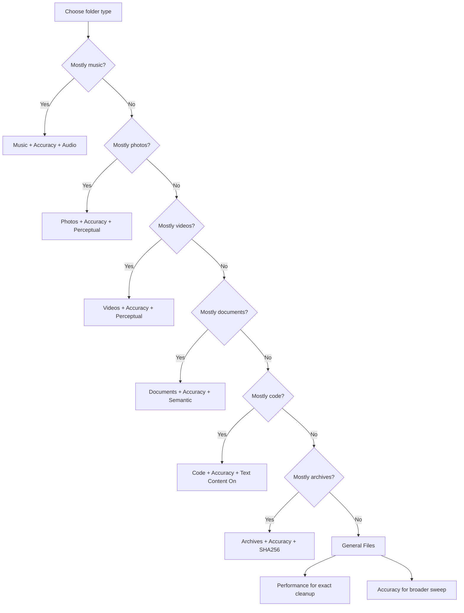

# Duplicate File Finder Settings Cheat Sheet

This guide is for the maintained app in [main.py](/C:/Users/naman/Desktop/Duplicate%20Identifier%20App/App/main.py) on this machine:

- CPU: Ryzen 9 5900HX
- RAM: 16 GB
- GPU: RTX 3050 Ti 4 GB
- CUDA: supported

## Global Defaults

Use these as your default baseline:

- `Enable Smart Presets`: `On`
- `Use GPU`: `On`
- `Use GPU for perceptual hashing`: `On`
- `Use parallel processing`: `On`
- `Mode`: `Accuracy` when quality matters
- `Mode`: `Performance` for large exact-only cleanup passes

## Best Settings by Data Type

### Music

Best for:
- same song with different names
- same song in different folders
- same song with different bitrate/encoding

Use:
- `Category`: `Music`
- `Mode`: `Accuracy`
- `Primary Focus`: `Audio`
- `Find similar files`: `On`
- `Compare by name`: `On`
- `Name similarity`: `85%`
- `Compare by size`: `On`
- `Size tolerance`: `3 MB`
- `Compare text content`: `Off`
- `GPU`: `On`

Expected behavior:
- catches same tracks even with different filenames
- usually catches transcoded copies
- helps you keep the better-quality copy after detection

Best workflow:
- scan album/library
- inspect similar groups
- keep higher bitrate / better codec / better metadata version

### Photos

Best for:
- resized copies
- recompressed copies
- near-identical images
- same image with different filenames

Use:
- `Category`: `Photos`
- `Mode`: `Accuracy`
- `Primary Focus`: `Perceptual`
- `Find similar files`: `On`
- `Compare by name`: `On`
- `Name similarity`: `80%`
- `Compare by size`: `On`
- `Size tolerance`: `0.5 MB`
- `Compare text content`: `Off`
- `Perceptual preset`: `Aggressive`
- `GPU`: `On`

Expected behavior:
- exact duplicates are content-based
- same filename alone does not make two images duplicates
- visually similar images can be grouped together

### Videos

Best for:
- same video in different containers
- re-encoded copies
- similar visual content

Use:
- `Category`: `Videos`
- `Mode`: `Accuracy`
- `Primary Focus`: `Perceptual`
- `Find similar files`: `On`
- `Compare by name`: `On`
- `Name similarity`: `85%`
- `Compare by size`: `On`
- `Size tolerance`: `10 MB`
- `Compare text content`: `Off`
- `Perceptual preset`: `Aggressive`
- `GPU`: `On`

Expected behavior:
- uses video fingerprinting/keyframes when available
- better than plain filename or size matching

### Documents

Best for:
- same document with edits
- similar reports/notes
- text-heavy duplicates with different filenames

Use:
- `Category`: `Documents`
- `Mode`: `Accuracy`
- `Primary Focus`: `Semantic`
- `Find similar files`: `On`
- `Compare by name`: `On`
- `Name similarity`: `85%`
- `Compare by size`: `On`
- `Size tolerance`: `1 MB`
- `Compare text content`: `On`
- `Content similarity`: `92%`
- `GPU`: `On`

Expected behavior:
- exact duplicates still use exact hashing
- similar documents are compared by extracted text / semantic path when available

### Code

Best for:
- copied source files
- renamed code files
- similar code with small changes

Use:
- `Category`: `Code`
- `Mode`: `Accuracy`
- `Primary Focus`: `SHA256`
- `Find similar files`: `On`
- `Compare by name`: `On`
- `Name similarity`: `85%`
- `Compare by size`: `On`
- `Size tolerance`: `1 MB`
- `Compare text content`: `On`
- `Content similarity`: `95%`
- `GPU`: `On`

Expected behavior:
- exact duplicate code is caught reliably
- similar text/code is also grouped when content overlap is strong

### Archives

Best for:
- duplicate `.zip`/`.7z`/`.tar` content
- archives with same payload and different names

Use:
- `Category`: `Archives`
- `Mode`: `Accuracy`
- `Primary Focus`: `SHA256`
- `Find similar files`: `On`
- `Compare by name`: `On`
- `Name similarity`: `85%`
- `Compare by size`: `On`
- `Size tolerance`: `1 MB`
- `Compare text content`: `Off`
- `GPU`: `On`

Expected behavior:
- exact archive duplicates are caught by exact hashing
- similar archives can also be matched by manifest/content comparison

### General Files

Best for:
- broad cleanup of mixed folders
- exact duplicate removal first

Use for safer first pass:
- `Category`: `General Files`
- `Mode`: `Performance`
- `Primary Focus`: `MD5`
- `Find similar files`: `Off`
- `GPU`: `On`

Use for broader cleanup:
- `Category`: `General Files`
- `Mode`: `Accuracy`
- `Primary Focus`: `MD5`
- `Find similar files`: `On`
- `Compare by name`: `On`
- `Compare by size`: `On`
- `Compare text content`: `On`

Expected behavior:
- best for mixed exact duplicate sweeps
- not as specialized as choosing the real content category

## Use-Case Answers

### 1. Same music, different names

Example:
- `001. Aperture.mp3`
- `056. Aperture.flac`

Recommended:
- `Music`
- `Accuracy`
- `Audio`

Reason:
- audio fingerprinting matters more than filename

### 2. Same music, one is better bitrate

Recommended:
- `Music`
- `Accuracy`
- `Audio`

Reason:
- the app should group them as same/similar content
- then you keep the better-quality file based on bitrate/sample rate/format

### 3. Same image name, different actual image

Example:
- `IMG_012.jpg`
- another `IMG_012.jpg` in a different folder

Recommended:
- `Photos`
- `Accuracy`
- `Perceptual`

Reason:
- same name alone should not make them duplicates
- actual visual similarity drives the grouping

## Fast Decision Tree

```text
Start
├─ Is the folder mostly music/audio?
│  ├─ Yes -> Category: Music
│  │  ├─ Want best detection? -> Mode: Accuracy -> Focus: Audio
│  │  └─ Want faster exact cleanup? -> Mode: Performance
│  └─ No
├─ Is the folder mostly photos/images?
│  ├─ Yes -> Category: Photos
│  │  ├─ Want near-duplicate matching? -> Mode: Accuracy -> Focus: Perceptual
│  │  └─ Only exact cleanup? -> Mode: Performance
│  └─ No
├─ Is the folder mostly videos?
│  ├─ Yes -> Category: Videos -> Mode: Accuracy -> Focus: Perceptual
│  └─ No
├─ Is the folder mostly documents/PDFs/text?
│  ├─ Yes -> Category: Documents -> Mode: Accuracy -> Focus: Semantic
│  └─ No
├─ Is the folder mostly source code?
│  ├─ Yes -> Category: Code -> Mode: Accuracy -> Compare text content: On
│  └─ No
├─ Is the folder mostly archives?
│  ├─ Yes -> Category: Archives -> Mode: Accuracy -> Focus: SHA256
│  └─ No
└─ Mixed folder -> Category: General Files
   ├─ Safe first pass -> Mode: Performance
   └─ Broader pass -> Mode: Accuracy
```

## Mermaid Graph



## Best Practical Routine

For a large messy drive:

1. Run `General Files + Performance` first.
2. Then scan category-specific folders separately:
   - music folders with `Music + Accuracy`
   - photo folders with `Photos + Accuracy`
   - document folders with `Documents + Accuracy`
3. Review similar groups before deleting.
4. Use move/export before bulk deletion if the data matters.

## Notes

- Smart Presets should usually stay enabled.
- Category matters more than manually forcing one generic focus across everything.
- For mixed folders, exact duplicate cleanup first is usually the safest approach.
